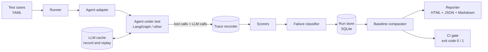

# Agent Evaluation Harness: Architecture

## Implementation status (2026-11-17)

This architecture is being implemented in the existing Model Regression Detector checkout. Milestones M1-M4 have an initial local implementation under the top-level `agent_eval/` package. M5 now has 30 Career Copilot cases (15 strong and 15 weak, including 3 sparse resumes) and a live-model recording that passed 30/30; the original 2-case, 5-repeat baseline is preserved as `main-2case`. M6 has a 30-entry LangChain record/replay cache; the 30-case replay passed with 30/30 cache hits and passed the gate against the new `main` baseline. A PR workflow has been added; GitHub execution still requires the baseline/cache artifacts to be committed and the workflow to run. The repository layout, CLI names, and SQLite normalization differ slightly from the proposal to preserve the existing project. M0's public-repository/CI push criteria and M7-M8's regression demo and release criteria remain open. See the README for the current local quickstart.

A framework that runs an LLM agent against a set of test cases, records every step it takes, scores the run, compares it with a baseline and fails the build when quality drops.

It extends the **Model Regression Detection System** (golden dataset, stored runs, baseline comparison, HTML report) from single LLM calls to **multi-step agents that call tools**.

## 1. Goals and non-goals

**Goals**
- Evaluate agents, not only prompts: tool choice, tool arguments, order of steps, final outcome, cost and latency.
- Classify *why* a run failed (wrong tool, bad arguments, loop, hallucinated answer, and so on).
- Catch regressions after a prompt, model or tool change, and block them in CI.
- Run cheaply and deterministically in CI by replaying recorded LLM responses.
- Work with any agent through a small adapter interface. The first target is the Career Copilot LangGraph agent.

**Non-goals**
- Not a general observability platform (tracing dashboards are a separate project).
- Not a training or fine-tuning tool.
- No web UI beyond the static HTML report.

## 2. System overview



Data flow for one run:

1. The **runner** loads test cases and runs each one `k` times through the adapter (`k` handles nondeterminism).
2. The **adapter** invokes the agent and returns a **trace**: every LLM call, tool call, tool result and the final answer, with timings and token counts.
3. **Scorers** turn each trace into metric values.
4. The **failure classifier** assigns one or more failure categories to each failed case.
5. The **run store** saves the run, cases, traces and scores in SQLite.
6. The **comparator** compares the run with the baseline run and flags regressions and improvements.
7. The **reporter** writes an HTML report, a JSON summary and a Markdown summary for the pull request.
8. The **CI gate** exits non-zero if any gated metric regresses beyond its threshold.

## 3. Components

### 3.1 Test case schema

Cases live in `datasets/*.yaml` and are validated with Pydantic.

```yaml
- id: match-resume-basic-001
  tags: [matching, happy-path]
  input:
    message: "Match my resume to job 123"
    context: {resume_id: "r-42"}
  expected:
    tool_calls:                      # ordered unless `unordered: true`
      - name: get_job
        args: {job_id: 123}          # exact match
      - name: match_job_to_resume
        args: {job_id: 123, resume_id: "r-42"}
    forbidden_tools: [delete_resume]
    outcome:
      contains: ["match score"]      # deterministic checks
      json_schema: schemas/match_result.json
      judge_rubric: rubrics/match_explanation.md   # optional LLM judge
  limits: {max_steps: 8, timeout_s: 60}
```

Argument matchers: `exact`, `regex`, `any`, `one_of`, `approx` (numbers).

### 3.2 Agent adapter interface

```python
class AgentAdapter(Protocol):
    name: str
    def run(self, case: TestCase) -> Trace: ...
```

Planned adapters:
- `FakeAgent`: scripted behaviour for unit-testing the harness itself.
- `LangGraphAdapter`: wraps the Career Copilot graph and records steps through LangGraph callbacks.
- `HttpAdapter` (optional): calls an agent exposed as an API.

### 3.3 Trace model

```python
class ToolCall:   name, args, result, error, latency_ms
class LLMCall:    model, prompt_tokens, completion_tokens, latency_ms, cached
class Trace:      case_id, steps: list[ToolCall | LLMCall], final_answer,
                  total_latency_ms, total_tokens, terminated_by  # "answer" | "max_steps" | "timeout" | "error"
```

### 3.4 Scorers

Each scorer returns a value from 0 to 1 plus a short explanation.

| Metric | Definition |
|---|---|
| `tool_selection` | Expected tools were called, no forbidden tool was called |
| `tool_args` | Arguments match the expected matchers for each matched call |
| `tool_order` | Calls follow the expected sequence (skipped when `unordered`) |
| `no_hallucinated_tool` | Every called tool exists in the agent's tool registry |
| `task_success` | All outcome checks pass (contains, schema, optional judge) |
| `step_efficiency` | Expected steps divided by actual steps, capped at 1 |
| `latency_ms`, `tokens` | Raw cost metrics, tracked but not 0–1 scores |

A case **passes** when `task_success == 1` and `tool_selection == 1`. The suite-level **task success rate** is the share of passing cases (with `k` repeats, also report pass@k and pass^k).

### 3.5 Failure classifier

Rules run in order over the trace and scores. A case can have several categories.

| Category | Rule |
|---|---|
| `wrong_tool` | A tool was called that is not expected |
| `missing_tool_call` | An expected tool was never called |
| `bad_args` | Right tool, arguments do not match |
| `wrong_order` | Right tools, wrong sequence |
| `hallucinated_tool` | Tool name not in the registry |
| `loop` | Same tool and arguments repeated 3 or more times, or `max_steps` reached |
| `unhandled_tool_error` | A tool returned an error and the agent ignored it |
| `wrong_answer` | Tool calls fine, outcome checks failed |
| `timeout` | Exceeded `timeout_s` |
| `agent_error` | The graph or adapter terminated with an unhandled exception |
| `rate_limit` | The model provider rejected a request because of rate limits |
| `cache_miss` | Replay mode has no response for the requested model input |

### 3.6 Run store

SQLite, one file, no server.

```
runs(id, created_at, git_sha, agent_name, model, prompt_version, config_json)
cases(run_id, case_id, repeat_idx, passed, terminated_by, latency_ms, tokens)
scores(run_id, case_id, repeat_idx, metric, value, explanation)
failures(run_id, case_id, repeat_idx, category)
traces(run_id, case_id, repeat_idx, trace_json)
baselines(name, run_id)
```

### 3.7 Baseline comparator

- Aggregates each metric across cases and repeats.
- Computes the delta against the baseline run for the suite and per tag.
- Applies thresholds from `eval.config.yaml`:

```yaml
gates:
  task_success_rate: {max_drop: 0.03}
  tool_selection:    {max_drop: 0.02}
  tool_args:         {max_drop: 0.03}
  p95_latency_ms:    {max_increase_pct: 25}
  avg_tokens:        {max_increase_pct: 20}
```

- Lists cases that flipped pass to fail (regressions) and fail to pass (improvements).
- Reports pass@k, pass^k and cases with mixed repeat outcomes.
- With `k > 1`, uses a minimum-effect rule so one flaky repeat does not fail the build.

### 3.8 LLM cache (record and replay)

- `record` mode: call the real LLM and save responses keyed by a hash of (model, messages, tools, temperature).
- `replay` mode: serve saved responses and fail on a cache miss. This makes CI free, fast and deterministic.
- The cache is refreshed deliberately (`make refresh-cache`), never silently.

### 3.9 Reporter

- `report.html`: summary cards, metric table with deltas, failure-category chart, per-case drill-down with the full trace.
- `summary.json`: machine-readable results.
- `summary.md`: short table for a pull request comment.

### 3.10 CLI

```
agent-eval run      --agent career_copilot --dataset datasets/ --repeats 3 --mode replay
agent-eval compare  --run latest --baseline main
agent-eval report   --run latest --out reports/
agent-eval gate     --run latest --baseline main      # exit 1 on regression
agent-eval baseline set --run latest --name main
```

### 3.11 CI (GitHub Actions)

- **On every pull request:** unit tests, then `run --mode replay`, then `gate`. Upload `report.html` as an artifact and post `summary.md` as a comment.
- **Nightly or manual:** `run --mode record` with the real LLM, publish the report, and open an issue if a gate fails.

## 4. Repository layout

```
agent-eval-harness/
├── README.md
├── ARCHITECTURE.md
├── pyproject.toml
├── eval.config.yaml
├── datasets/
│   └── career_copilot.yaml
├── schemas/                  # JSON schemas for outcome checks
├── rubrics/                  # optional LLM-judge rubrics
├── src/agent_eval/
│   ├── models.py             # TestCase, Trace, Score (Pydantic)
│   ├── runner.py
│   ├── adapters/
│   │   ├── base.py
│   │   ├── fake.py
│   │   └── langgraph.py
│   ├── scorers/
│   ├── failures.py
│   ├── store.py
│   ├── compare.py
│   ├── cache.py
│   ├── report/
│   └── cli.py
├── tests/
│   ├── unit/
│   └── integration/
├── .github/workflows/
│   ├── ci.yml
│   └── nightly.yml
└── docs/
    ├── architecture.png
    └── sample-report.html
```

**Stack:** Python 3.11+, Pydantic, Typer (CLI), SQLite, Jinja2 (report), pytest, ruff, GitHub Actions.

**Decision:** create this as a new repository and port the comparator and report code from the Model Regression Detection System. Link the two READMEs to each other.

## 5. Milestones

Each milestone ends with a working state and a push to GitHub. Do not start the next one until the "Done when" line is true. Estimates assume part-time work and total about 2 weeks.

### M0: Repository skeleton (0.5 day) → push #1
- Create the repo, `pyproject.toml`, ruff, pytest, `src/` layout and a license.
- Add a CI workflow that only runs lint and an empty test.
- Add `ARCHITECTURE.md` (this file) and a short README stub.
- **Done when:** CI is green on `main` and the repo is public.
- **Commit:** `chore: project skeleton and CI`

### M1: Data models and the fake agent (1 day) → push #2
- Implement `TestCase`, `Trace`, `ToolCall`, `LLMCall` and `Score` in `models.py`.
- Implement the YAML loader with validation and clear error messages.
- Implement `FakeAgent` that replays a scripted trace.
- **Done when:** unit tests load sample cases and the fake agent returns a valid trace.
- **Commit:** `feat: data models, dataset loader, fake agent`

### M2: Scorers and the failure classifier (2 days) → push #3
- Implement the scorers in 3.4 and the argument matchers.
- Implement the failure classifier in 3.5.
- Test every scorer and every failure category with fake traces, including edge cases (empty trace, repeated calls, unknown tool).
- **Done when:** one unit test per failure category passes and scorer coverage is 90% or higher.
- **Commit:** `feat: scorers and failure classifier`

### M3: Runner, run store and CLI (1.5 days) → push #4
- Implement the runner with repeats, timeouts and `max_steps`.
- Implement the SQLite store with the schema in 3.6.
- Implement `agent-eval run` and `baseline set` in the CLI.
- **Done when:** `agent-eval run --agent fake` creates a run in SQLite and prints a summary.
- **Commit:** `feat: runner, sqlite store, cli`

### M4: Comparator, gate and HTML report (2 days) → push #5
- Port the comparison logic from the regression system and add thresholds and per-tag deltas.
- Implement `compare`, `gate` (exit code) and `report` (HTML, JSON, Markdown).
- Test the gate with fake runs: an identical run passes, a degraded run fails.
- **Done when:** a degraded fake run fails the gate and the HTML report shows the regression and its failure categories.
- **Commit:** `feat: baseline comparison, gate, reports`

### M5: Career Copilot adapter and real dataset (2 days) → push #6
- Implement `LangGraphAdapter` using LangGraph callbacks to capture steps.
- Write 30 or more test cases covering the happy path, missing information, ambiguous requests, tool errors and forbidden actions.
- Run against the real agent and set the first baseline.
- **Done when:** the harness runs the real agent end to end and the report shows real traces.
- **Commit:** `feat: langgraph adapter and career copilot dataset`

### M6: Record and replay cache plus CI gate (1.5 days) → push #7
- Implement the LLM cache (`record` and `replay`) and commit the recorded cache for the dataset.
- Add the PR workflow: replay run, gate, report artifact, PR comment.
- Add the nightly workflow in `record` mode.
- **Done when:** a pull request that weakens a prompt turns the CI check red and the comment shows which cases flipped.
- **Commit:** `feat: llm cache and ci gating`

### M7: Prove it catches a real regression (1 day) → push #8
- On a branch, make a deliberate change (a worse prompt, a renamed tool argument, a removed tool description).
- Show the harness catching it. Save the failing PR and its report as evidence.
- Fix the change, show the gate going green, and merge.
- **Done when:** the README links to the red PR and the green PR.
- **Commit:** `docs: regression demo`

### M8: Documentation and release (1 day) → push #9, tag `v0.1.0`
- Write the README: problem, architecture diagram (export the Mermaid diagram as `docs/architecture.png`), results table, quickstart (`pip install`, `agent-eval run`) and how to add an adapter.
- Add `docs/sample-report.html`, CI and coverage badges, and a "Limitations" section.
- Link the project from your CV and from the Career Copilot README.
- **Done when:** a stranger can clone the repo and reproduce a run in under 5 minutes.
- **Tag:** `v0.1.0`

## 6. Definition of done for the whole project

- [ ] Public GitHub repo with green CI and a `v0.1.0` tag
- [ ] At least 30 test cases and 6 scorers
- [ ] At least 8 failure categories, each with a unit test
- [ ] Deterministic CI using replayed LLM responses
- [ ] Regression gate demonstrated by a red PR and a green PR
- [ ] README with an architecture diagram, results table and sample report
- [ ] Real numbers on your CV, such as "N cases, M metrics, caught K regressions"

## 7. Risks and mitigations

| Risk | Mitigation |
|---|---|
| Flaky agent results | Repeat each case `k` times and use thresholds, not exact equality |
| LLM judge disagrees with itself | Prefer deterministic checks, use the judge only for open-ended answers, pin its model and temperature |
| Cache goes stale after a prompt change | The cache key includes the full prompt, so a changed prompt is a miss and forces an explicit refresh |
| Scope grows | Anything not in M0 to M8 goes into a `ROADMAP.md`, not this release |

## 8. Future work

- Adapter for the Arabic and English RAG project (retrieval hit rate, citation correctness).
- Multi-turn conversation cases.
- Trace export to Langfuse or OpenTelemetry.
- Simple dashboard for run history.
